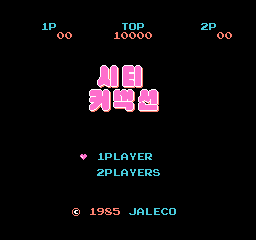

# 시티 커넥션 — 패미컴 / NES

패미컴 / NES **시티 커넥션** 한글 번역 패치 프로젝트입니다. 자동차로 도로를 달리며 발판을 칠하는 액션 게임입니다.

> **최종 배포본 · 2026-08-12**

<!-- game-preview:start -->

  

**한글 타이틀 · 작업 당시 캡처** — logo22 Mesen 캡처 작업 당시 화면이며 최종 배포본의 화면 검증을 의미하지 않습니다.
<!-- game-preview:end -->

## 다운로드 및 적용 방법

1. 아래 체크섬 또는 상세 안내와 일치하는 원본을 준비합니다.
2. [최종 배포 패치 다운로드](https://github.com/akuma815/nes-city-connection-kr-patch/releases/tag/release-20260812)에서 ZIP을 받아 모두 압축 해제합니다.
3. 원본 ROM 또는 ISO를 동봉 `apply.cmd`에 끌어다 놓습니다.
4. 생성된 한글판 파일의 SHA-256을 확인하고 실행합니다.

## 주의사항

- 일본판 원본 전용입니다.
- 실기 및 다른 에뮬레이터 검증은 배포 안내 기준 미실시입니다.
- 원본 게임·BIOS 및 패치가 적용된 게임 이미지는 포함하지 않습니다.

## 체크섬

| 구분 | SHA-256 |
| --- | --- |
| 패치 파일 `CityConnection_KR_20260812.xdelta` | `579a69034140fe18a0ed3db8a68561261eb7da8c3a63fef00699d4989d6dad7b` |
| 원본 JP | `6476d10be301a331904bb42db0bd9811d13ff4ba991c32611b7c746d3560f61f` |
| 패치 후 이미지 JP | `03f0de5a1bac876873cdbae143d84980f99154bb9b796b2db4edbd5e6079fca4` |
| 배포 압축 파일 | `bb0c4dc997305d469f5d71e6abd04950d0a9fb2bde1ee234515b6599e26d014a` |

지원 원본의 세트·리비전 및 해시는 [상세 패치 안내](docs/PATCH_GUIDE.txt)를 확인하세요.

## 소스 및 작업 기록

[공개 소스 구성과 빌드 전제](docs/SOURCE_GUIDE.md) · [상세 패치 안내](docs/PATCH_GUIDE.txt)

[최종판 재빌드 안내](docs/rebuild/README.md): 본문 폰트와 승인 로고 타일 설정을 포함했습니다. 지원 일본판 원본 ROM만 별도로 준비하면 최종판을 재현할 수 있습니다.
